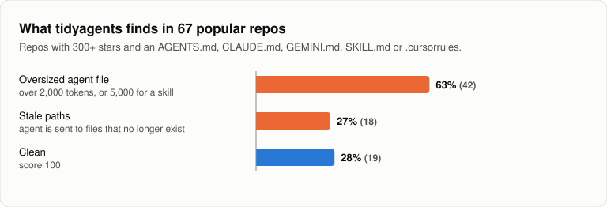
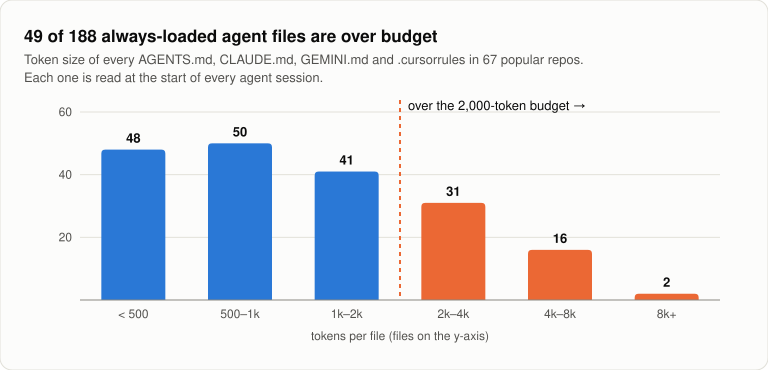
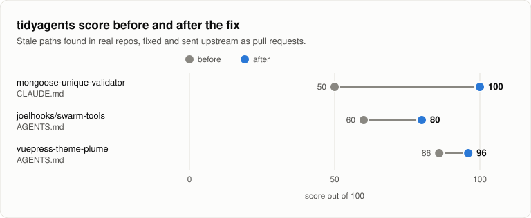

# tidyagents

[](LICENSE)


Lint, score and tidy your AI agent instruction files: `AGENTS.md`, `CLAUDE.md`, `GEMINI.md`, `SKILL.md`, `.cursorrules` and `.github/copilot-instructions.md`.

Agent files grow quietly. Code moves, files get renamed, and the instructions your agent reads every session keep pointing at things that no longer exist. `tidyagents` finds the rot and cleans up what's safe to clean.

```bash
npx github:vishwakulkarni/tidyagents
```

## The numbers

We ran `tidyagents` on **67 popular open-source repos** (300+ stars, actively maintained, 418 agent files, ~851k tokens of agent instructions).

<p align="center"></p>

- **27% (18 repos) send their agent to files that no longer exist**: 97 stale paths in total.
- **63% (42 repos) have at least one oversized file.** Even Anthropic's own `claude-api` skill is 26,280 tokens.

### Bloat costs you on every session

Always-loaded files (`AGENTS.md`, `CLAUDE.md`, `GEMINI.md`, `.cursorrules`) are read before the agent does any work. A quarter of them are over budget; the largest is 15,125 tokens. The median is 929.

<p align="center"></p>

### Before and after

Real fixes found by `tidyagents` in public repos and sent upstream:

<p align="center"></p>

| Repo | File | What was stale | Score | Fix |
|---|---|---|---|---|
| mongoose-unique-validator (543★) | `CLAUDE.md` | Whole test layout: tests moved from `.js` files to `.ts` and new folders | **50 → 100** | [PR #169](https://github.com/mongoose-unique-validator/mongoose-unique-validator/pull/169) |
| joelhooks/swarm-tools (749★) | `AGENTS.md` | Skills folder renamed `.opencode/skills/` → `.opencode/skill/` | **60 → 80** | [PR #212](https://github.com/joelhooks/swarm-tools/pull/212) |
| vuepress-theme-plume (497★) | `AGENTS.md` | `ConfigLoader.ts` moved into `features/` | **86 → 96** | [PR #1080](https://github.com/pengzhanbo/vuepress-theme-plume/pull/1080) |

### Big-name repos

| Repo | Agent files | Score | Top finding |
|---|---|---|---|
| anthropics/skills | 20 | 90 | `claude-api` skill is 26,280 tokens |
| vercel/ai | 18 | 90 | root `AGENTS.md` is 4,054 tokens, loaded every session |
| anthropics/claude-cookbooks | 7 | 96 | `skills/CLAUDE.md` is 2,094 tokens |
| google-gemini/gemini-cli | 12 | 96 | `skill-creator` skill is 5,023 tokens |
| google/adk-python | 11 | 100 | clean |
| openai/codex | 8 | 100 | clean |

Scanned November 2026 with tidyagents 0.1.0. Every finding in these tables was checked by hand.

## Quick start

```bash
npx github:vishwakulkarni/tidyagents
```

```
$ npx tidyagents

CLAUDE.md  57/100  (70 tokens)
  ✗ line 6   references `scripts/deploy.sh`, which does not exist  [missing-path]
  ✗ line 7   runs script "typecheck", which is not in package.json  [missing-script]
  · line 9   3 blank lines in a row  [blank-lines] fixable
  ⚠ line 11  "follow best practices" is too vague for an agent to act on  [vague]
  ✗ line 12  contradicts line 4; keep one of them  [contradiction]
  ⚠ line 13  repeats line 5  [duplicate] fixable

Score: 57/100  ·  2 fixable, run tidyagents fix
```

## Why tidyagents

- **Zero dependencies, no AI calls, works offline.** One command.
- **Built to stay quiet when unsure.** It skips gitignored build output, files the instructions say to create, examples like `e.g. src/foo/`, and skills (which describe other people's projects). Tuned against 67 real repos to cut false positives.
- **Safe to run.** `fix` shows a diff and asks before it writes, and never deletes a line it isn't sure about.
- **Fits in CI.** `--min-score` fails the build when agent files rot.

## For teams and companies

Every engineer's agent reads the same instruction files at the start of every session. When those files rot, the cost multiplies across the team: wrong paths send agents on wasted searches, and bloat is paid for on every run. For example, a 4,000-token `CLAUDE.md` read by 50 engineers in 10 sessions a day is 2 million input tokens a day before any work starts.

- **Safe to adopt.** Apache 2.0, with an explicit patent grant. Free for commercial use, with no copyleft.
- **Nothing to audit but ~470 lines.** No dependencies means no supply-chain risk and nothing for security review to chase.
- **Your instructions never leave the machine.** No network calls, no telemetry, no model calls. It reads files and runs `git check-ignore`, nothing else.
- **Deterministic.** The same files always get the same score, so it is a stable CI gate.
- **Monorepo aware.** Scripts are checked against every `package.json` in the repo.
- **Works across agents.** One check for Claude Code, Codex, Gemini CLI, Cursor and GitHub Copilot files.
- **Reports in JSON.** Feed `--json` into a dashboard to track agent-file health across every repo in your org.

### Roll it out

1. Run `npx github:vishwakulkarni/tidyagents` in your largest repo and fix what it finds.
2. Add the [CI check](#use-in-ci) with `--min-score 80` so new rot fails the pull request.
3. Track it across repos with `--json`:

```bash
for repo in */; do
  (cd "$repo" && npx -y github:vishwakulkarni/tidyagents --json | jq -c --arg r "$repo" '{repo: $r, score}')
done
```

## Commands

The examples below use `tidyagents`; until it's on npm, run it as `npx github:vishwakulkarni/tidyagents`.

```bash
tidyagents              # score every agent file and list issues
tidyagents fix          # show a diff of safe fixes, ask, then apply
tidyagents badge        # print a README badge for your score
tidyagents init         # create a starter AGENTS.md
```

You can pass specific files, e.g. `npx tidyagents CLAUDE.md`. With no files, it searches the current folder (skipping `node_modules` and hidden folders other than `.claude`).

| Option | |
|---|---|
| `--min-score <n>` | Exit with code 1 if the score is below `n` |
| `--json` | Print check results as JSON |
| `-y, --yes` | Apply fixes without the prompt |

## What it checks

| Rule | Severity | Auto-fix |
|---|---|---|
| `missing-path`: a backticked path like `src/old.js` whose top folder exists but the file is gone. Gitignored paths, lines about creating files or giving examples, and `SKILL.md` files are skipped | error | no, it may be a file the agent should create |
| `missing-script`: `npm run x` / `pnpm run x` where no `package.json` in the repo defines `x` | error | removes the bullet if nothing else in it works |
| `contradiction`: "always X" and "never X" in the same file | error | no, you pick |
| `duplicate`: the same top-level bullet twice in one section, ignoring case and punctuation | warn | removes the repeat |
| `vague`: short rules like "write clean code" an agent can't act on | warn | no |
| `size`: over 2,000 tokens (warn) or 4,000 (error); `SKILL.md` files load only when used, so 5,000 / 10,000 | warn/error | no |
| `blank-lines`: runs of blank lines | info | collapses them |

Content inside code fences is ignored, and table rows are ignored for duplicates and contradictions.

**Scoring:** each file starts at 100 and loses 10 per error, 4 per warning and 1 per info. The repo score is the lowest file score.

**Fix safety:** `fix` only deletes lines, always shows them first, and never writes without `--yes` or a `y` at the prompt. If it's unsure, it flags instead of deleting.

## Use in CI

```yaml
# .github/workflows/agent-files.yml
name: agent files
on: [pull_request]
jobs:
  tidyagents:
    runs-on: ubuntu-latest
    steps:
      - uses: actions/checkout@v4
      - uses: actions/setup-node@v4
        with:
          node-version: 20
      - run: npx -y github:vishwakulkarni/tidyagents --min-score 80
```

## Badge

```bash
tidyagents badge
```

Prints markdown like ``. The badge is static, so re-run it after you improve your score.

## License

[Apache License 2.0](LICENSE). Copyright 2026 Vishwanath Kulkarni.
