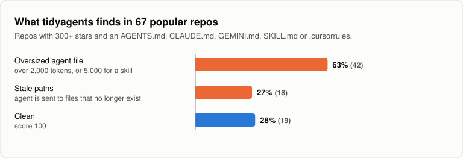
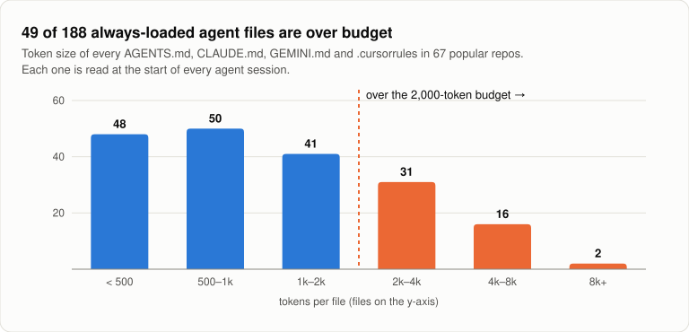

# 27% of popular repos send their AI agent to files that don't exist

*November 2026 · Vishwanath Kulkarni*

`AGENTS.md`, `CLAUDE.md`, `GEMINI.md`, `.cursorrules`: most active repos now have at least one file written for AI coding agents. The agent reads it at the start of every session and trusts it. Nobody reviews it again.

So I wrote a linter for these files, [tidyagents](https://github.com/vishwakulkarni/tidyagents), and ran it on 67 popular open-source repos to see how they hold up.

## What I scanned

- **67 repos**, each with 300+ stars, recent commits, and at least one agent instruction file.
- **418 agent files** holding **~851k tokens** of instructions.
- Six file types: `AGENTS.md`, `CLAUDE.md`, `GEMINI.md`, `SKILL.md`, `.cursorrules` and `.github/copilot-instructions.md`.

Every repo was a fresh clone, checked with `tidyagents --json` (version 0.1.0). The linter is deterministic and makes no AI calls, so anyone can rerun this.



## Finding 1: a quarter of repos point the agent at files that are gone

**18 of 67 repos (27%) reference files that no longer exist, 97 stale paths in all.**

The pattern is always the same: code moves, the instructions don't. A few real examples:

- **mongoose-unique-validator**: `CLAUDE.md` described the whole test layout as `.js` files. The tests had moved to `.ts` in new folders. Score 50; after the fix, 100 ([PR](https://github.com/mongoose-unique-validator/mongoose-unique-validator/pull/169)).
- **swarm-tools**: `AGENTS.md` pointed at `.opencode/skills/`. The folder had been renamed to `.opencode/skill/`. Score 60 → 80 ([PR](https://github.com/joelhooks/swarm-tools/pull/212), auto-closed because the repo only accepts vouched contributors).
- **vuepress-theme-plume**: `AGENTS.md` pointed at `ConfigLoader.ts`, which had moved into `features/`. Score 86 → 96 ([PR](https://github.com/pengzhanbo/vuepress-theme-plume/pull/1080)).
- One repo's `web/CLAUDE.md` named 14 files that no longer exist, including a whole set of mobile design docs.

A stale path is worse than no path. The agent goes looking for the file, fails, then searches the tree or guesses. You pay for that detour in time and tokens.

## Finding 2: always-loaded files are getting big

Some agent files load only when needed (`SKILL.md`). The rest, `AGENTS.md`, `CLAUDE.md`, `GEMINI.md` and `.cursorrules`, are read before every session. Of the 188 always-loaded files:

- **49 (26%) are over 2,000 tokens**, and 18 are over 4,000.
- The largest is **15,125 tokens**. The median is 929.



Size adds up across a team. A 4,000-token `CLAUDE.md` read by 50 engineers in 10 sessions a day is 2 million input tokens a day before anyone has typed a request. Long files also bury the rules that matter: the one line about not touching the migrations folder sits next to 300 lines of history.

Skills get a bigger budget (5,000 tokens) because they load only when used. Even so, Anthropic's own `claude-api` skill in `anthropics/skills` is 26,280 tokens.

## Finding 3: the best-kept repos are clean

It isn't hopeless. `google/adk-python` and `openai/codex` scored 100. `anthropics/claude-cookbooks` and `google-gemini/gemini-cli` scored 96. In the 67-repo sample, 19 repos (28%) had no findings at all.

## What the linter checks

| Rule | Example |
|---|---|
| `missing-path` | `src/api/auth.ts` is referenced but gone |
| `missing-script` | `npm run typecheck`, but no `package.json` defines it |
| `size` | over 2,000 tokens for always-loaded files |
| `contradiction` | "always use semicolons" and "never use semicolons" |
| `duplicate` | the same bullet twice in one section |
| `vague` | "write clean code" |

It was tuned against these 67 repos to avoid false alarms. It skips gitignored build output, paths the instructions say to create, `e.g.` examples, and skills, which describe other people's projects. When it's unsure, it stays quiet. `tidyagents fix` only removes what's safe (dead script lines, duplicates, extra blank lines), shows a diff first, and asks before writing.

## Limits

- Token counts are estimates (characters / 4), not a specific tokenizer.
- A missing path is sometimes intentional, such as a file a setup script creates. The linter reports it but never deletes it.
- 67 repos is a sample, not a census. The numbers will move as these repos change.

## Try it

```bash
npx tidyagents
```

Or fail pull requests when agent files rot:

```yaml
- uses: vishwakulkarni/tidyagents@v1
  with:
    min-score: 80
```

Zero dependencies, no network calls, Apache 2.0. Source and issues: [github.com/vishwakulkarni/tidyagents](https://github.com/vishwakulkarni/tidyagents).
